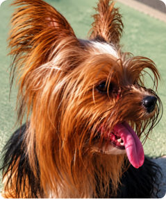

# MEL Design System 1.2

Fonte única da verdade visual. **Nenhuma tela nova sem estes tokens e componentes.**
Personalidade: premium, humana, acolhedora, confiável, sem estética infantil, com urgência só onde precisa.

## 1. Onde está cada coisa

| O quê | Arquivo |
|---|---|
| Cores, raios, sombras, movimento, gradientes (TS — cartazes, mapa, Expo) | `packages/ui-tokens/src/tokens.ts` |
| As mesmas variáveis em CSS (`--mel-*`) | `packages/ui-tokens/src/tokens.css` |
| Tokens → classes Tailwind, tipografia, animações | `apps/web/app/globals.css` |
| Componentes base | `apps/web/components/ui/*` |
| Marca (símbolo provisório, ilustração da rede) | `apps/web/components/brand/*` |

`tokens.test.ts` falha se TS e CSS divergirem ou se um par de texto/fundo não atingir **WCAG AA (4,5:1)**; bordas de foco e ícones de status precisam de 3:1.

## 2. Cores e temas (v1.1)

**Identidade: Honey Gold + Ink.**

- **MEL Honey Gold** (`honey-50…950`, marca = `honey-500 #C88924`): dourado/caramelo da pelagem da Mel. É quente, não metálico.
- **MEL Ink** (`ink-950…600`): o contraponto sofisticado.
- **Coral** (`coral-*`): só apoio emocional (urgência moderada, ilustrações, afeto). **Nunca é CTA padrão.**
- **Teal**: conexão, muito discreto.
- Gradiente `--mel-gradient-honey`: raro (hero especial, momento de sucesso). Botões comuns usam cor sólida.

**Tokens semânticos.** Componentes usam só estes, que mudam com o tema:

| Token (classe) | Claro | Escuro | Uso |
|---|---|---|---|
| `bg-background` / `bg-surface` / `bg-surface-muted` / `bg-surface-elevated` / `bg-surface-warm` / `bg-input` | #FBFAF7 / #FFF / #F7F4EE / #FFF / #FFF9F0 / #FFF | #0D1117 / #151B23 / #1B222C / #202833 / #111923 / #1B222C | fundos |
| `text-foreground` (= `text-text-primary`), `text-text-secondary`, `text-text-muted` | Ink / #667085 / #98A2B3 | #F7F4EE / #B8C0CC / #858F9E | texto (muted só para placeholder) |
| `bg-primary` + `text-primary-foreground`, `hover:bg-primary-hover` | **#875215** + branco, hover #6D4218 | **#DFA33B** + #15100A, hover #EFC15D | CTA principal |
| `bg-primary-soft` + `text-primary-soft-foreground` | #FFF0C7 + #6D4218 | #342711 + #EFC15D | seleção, destaque suave |
| `text-link` | #875215 | #EFC15D | links |
| `text-brand`, `bg-brand-soft`, `brand-ring` | honey 500 | honey 400 | símbolo, ilustração, ícones de marca |
| `focus` | #A96D18 | #DFA33B | anel/borda de foco (≥ 3:1) |
| `bg-inverse-surface` + `text-inverse-foreground` | Ink + branco | #2A3340 + creme | toast |
| `shadow-xs…lg`, `shadow-primary` | sombras suaves | sombras discretas; `shadow-primary` = brilho dourado quase imperceptível | elevação |

**Por que o CTA claro é `honey-700`.** Com texto branco, `honey-500` tem 3,0:1 e `honey-600` tem 4,3:1; os dois reprovam AA. O `honey-700` tem 6,5:1. No escuro, o dourado claro usa texto quase preto (8,4:1). Trocar é um token só: `primary`.

**Status (cor semântica ≠ cor da marca).** PERDI MEU PET continua vermelho.

| Tom | Classe | Uso |
|---|---|---|
| texto | `text-status-{lost,found,sighting,adoption,info}` | texto e ícones (mais claro no escuro) |
| fundo | `bg-status-*-soft` | fundo suave |
| sólido | `bg-status-*-solid` | preenchimento com texto branco (igual nos dois temas) |
| vivo | `status-*-accent` | pinos, pontos e ícones do mapa |

Também `danger` (texto) e `danger-solid` (botão destrutivo).

**Regra:** é proibido usar cor direta (`bg-[#C88924]`, `text-[#18212F]`) quando existe token. `tokens.test.ts` testa **cada par texto/fundo nos dois temas** (AA 4,5:1; foco 3:1) e falha se o `tokens.css` não for o gerado a partir de `tokens.ts` (`npm run tokens -w @mel/ui-tokens`).

### Temas: Claro, Escuro e Sistema

- `<html data-theme="light|dark" data-theme-pref="system|light|dark">`.
- **Sem flash:** um script mínimo no `<head>` (`lib/theme/theme.ts`) aplica o tema antes da primeira pintura. Sem JavaScript, vale `prefers-color-scheme`.
- **Primeiro acesso = Sistema.** A escolha manual fica no `localStorage` (`mel-theme`). No modo Sistema, o tema acompanha a troca do aparelho em tempo real.
- **`ThemeProvider` / `useTheme()`** → `{ theme, resolvedTheme, setTheme }`. É o único lugar com lógica de tema. Para sincronizar com o perfil depois do login, basta mexer em `setTheme`.
- **`ThemeSwitcher`:** botão discreto. No desktop abre um menu; no celular, um bottom sheet. Já está no `/entrar`. `ThemeOptions layout="segmented"` fica em Perfil → Aparência.
- **Troca suave:** só as cores fazem transição (220 ms), e só durante a troca. Respeita `prefers-reduced-motion`.
- **Fotos não recebem filtro no escuro.**
- O autopreenchimento do navegador é estilizado com os tokens.
- **Mapa:** `MapOptions.theme` já escolhe o estilo claro ou escuro no provider. As telas passam a usar o estilo escuro quando forem redesenhadas.
- **Cartazes e pinos do mapa** usam `colors` (paletas + tema claro): cartaz é sempre claro.

**Teste visual obrigatório de toda tela nova:** claro e escuro, no celular e no desktop.

## 2b. Mel Beacon: o símbolo da MEL (v1.2)

*A Mel, que deu origem a tudo. A foto original fica em `apps/web/public/brand/mel-origem.webp` e é usada no componente `BrandStory`, na home. Tem 239×287 px, então deve aparecer pequena (até cerca de 112 px) e nunca com filtro.*

> "A MEL nasceu da busca por uma Yorkshire chamada Mel. Seu desaparecimento revelou um problema maior: quando um animal desaparece, informações ficam espalhadas entre grupos, cartazes, redes sociais e pessoas que não conseguem se conectar. O Mel Beacon mantém essa história no centro da marca. Uma pequena Mel deu origem a uma grande rede."

**Mel Beacon = Mel + localização + busca + conexão + esperança de reencontro.** A cabeça de uma Yorkshire, com as orelhas marcantes e o pelo, converge para a ponta de um pino. O focinho é o ponto de localização. Leitura em dois níveis: primeiro "é o símbolo da MEL", depois "há uma cachorrinha nele".

- **Proposta escolhida: C ("mais reconhecível").** Ela foi redesenhada em **vetor**: simétrica, sem brilho/3D, normalizada num quadrado 512. A fonte única é `apps/web/components/brand/beacon.json`.
  - `detailed`: a partir de 48 px.
  - `simple`: até 32 px. É a silhueta sólida com o focinho vazado, legível em favicon.
- **Não é ícone de status.** Perdido, encontrado, avistamento e adoção têm ícones e cores próprios.
- **Cores:** no claro, ladrilho Honey + símbolo Ink. No escuro, ladrilho Ink com contorno sutil + Honey luminoso. Tokens: `beacon-tile`, `beacon-glyph`, `beacon-ring`. Monocromáticos: Honey, Ink, branco e Ivory.
- **Componentes:** `MelMark` (`variant="tile" | "glyph"`; escolhe sozinho a versão pelo tamanho) e `MelLogo` (lockup [Beacon] MEL). Símbolo e palavra também funcionam separados.
- **Arquivos gerados** (`npm run brand:icons`, a partir do vetor):

| Arquivo | Uso |
|---|---|
| `app/favicon.ico` (16/32/48) e `app/icon.svg` | favicon, versão simples |
| `app/apple-icon.png` | ícone Apple, sangrado |
| `public/brand/app-icon-192/512.png` e `app-icon-maskable-512.png` | PWA (M16) |
| `public/brand/notification-96.png` | notificação Android: branco sobre transparente |
| `public/brand/mel-beacon-{honey,ink,white,ivory,tile-light,tile-dark}.svg` | marca |

- **Retrato da Mel (proposta, aguardando aprovação):** ilustração vetorial plana feita a partir da foto original (`public/brand/mel-retrato.svg` e os ladrilhos `mel-retrato-tile-{light,dark}.svg`). Tem 6 tons de caramelo e escuro, mais a língua; o fundo foi removido. Comparação em `docs/design-review/mel-retrato.png`. Por ter muitos detalhes, funciona a partir de ~64 px (avatar oficial, história, redes sociais). Abaixo disso, o Mel Beacon continua sendo o símbolo.
- **Ilustração da rede:** o Beacon no centro e pessoas conectadas (Honey, Ink/Ivory, um Teal discreto, linhas suaves). A cada 3,4 s sai da MEL um pulso de radar de baixa opacidade, e cada nó responde de leve quando o pulso passa (escala 1,1). Com `prefers-reduced-motion`, nada se move.
- **Não fazer:** patinha ou coração no pino, cartoon, foto da Mel como logo, gradiente metálico, efeito 3D, laço, olhos de personagem.
- **Origem dos arquivos:** as pranchas recebidas eram recortes de uma imagem gerada. Não tinham transparência, traziam o fundo creme embutido e estavam fora de centro; o favicon de 16 px tinha 2×3 px de símbolo; a notificação vinha com a bolinha vermelha embutida; os monocromáticos eram de outra proposta (A). Por isso o símbolo foi vetorizado e todos os tamanhos são gerados do vetor.

## 3. Tipografia: Plus Jakarta Sans (variável, `next/font`, self-hosted)

| Classe | Uso | Tamanho/linha |
|---|---|---|
| `text-4xl` | Display | 40/46 |
| `text-3xl` | H1 | 32/39 |
| `text-2xl` | H2 | 26/33 |
| `text-xl` | H3 | 21/28 |
| `text-lg` | Title | 18/25 |
| `text-body-lg` | Body large | 17/27 |
| `text-base` | Body (padrão do `body`) | 15,5/24 |
| `text-sm` | Small | 14/20 |
| `text-caption` | Caption | 12/17 |

`font-semibold` = **650**. Títulos com tracking levemente negativo.

## 4. Espaço, raio, sombra, movimento

- Espaço: escala de 4 px do Tailwind (4…80). Margem lateral `--mel-page-gutter`: 20 px, ou 16 px abaixo de 360 px.
- Raio: `rounded-sm` 10 · `rounded-md` 14 (inputs, botões) · `rounded-lg` 18 · `rounded-card` 20 · `rounded-hero` 28 · `rounded-full`.
- Sombra: `shadow-xs` · `shadow-sm` (cartões) · `shadow-md` (flutuantes) · `shadow-lg` (modais/sheets).
- Movimento: 120/200/320 ms, `ease-mel` = `cubic-bezier(.2,.8,.2,1)`. Animações: `animate-enter` (entrada), `animate-sheet-up`, `animate-pop`, `animate-toast`, `animate-shimmer`. Botão pressionado = `scale(.985)`. Tudo desliga com `prefers-reduced-motion`.
- **Movimento em CSS, sem Framer Motion por enquanto.** Cobre tudo que o DS pede hoje sem custo de JavaScript (performance em celular). Reavaliar quando houver gestos, como arrastar o bottom sheet.

## 5. Componentes base (`components/ui`)

| Componente | Notas |
|---|---|
| `Button`, `ButtonLink`, `IconButton` | variantes primary / secondary / ghost / danger / soft; 52 px (lg) ou 48 px (md); loading com spinner; pressed/focus/disabled |
| `TextField`, `PasswordField`, `TextareaField`, `SelectField` | 52 px, rótulo acima, ação ao lado do rótulo, anel de foco coral, erro com ícone abaixo. **O erro só aparece após blur com conteúdo ou envio** |
| `SegmentedControl` | abas ARIA com indicador deslizante; navega com ←/→ |
| `Alert`, `ErrorState`, `EmptyState`, `LoadingState` | ícones Lucide; o estado vazio sempre traz contexto |
| `StatusBadge` | pílula, ícone + texto (`solid` para usar sobre fotos) |
| `Card`, `SectionHeader`, `Divider`, `Skeleton`, `PetCardSkeleton` | |
| `Toast` (`useToast`) | provider no layout raiz, some em 6 s, nunca `alert()` |
| `BottomSheet` | `<dialog>` nativo: sobe do rodapé no celular, cartão central no desktop |
| `MelLogo`, `MelMark`, `NetworkIllustration` | símbolo provisório em Honey Gold com pino Ink; `MelMark` é o único ponto de troca do logo definitivo |
| `ThemeProvider`, `useTheme`, `ThemeSwitcher`, `ThemeOptions` | temas Claro, Escuro e Sistema |

Ícones: **Lucide** apenas, traço 1,75–2.

## 6. Auditoria da interface (28/10/2026)

**Já resolvido nesta etapa:**
- Paleta marrom trocada pela paleta Coral/Ink em todas as telas, via tokens.
- Fonte Figtree trocada por Plus Jakarta Sans.
- Botões, campos, alertas, estados e selos redesenhados.
- Senha com ícone de olho em vez de checkbox (Field).
- `/entrar` refeito por completo.
- Fundo do diálogo de denúncia corrigido: `bg-black` não existia nos tokens, e o fundo não escurecia.

**Violações que continuam, por tela (refazer uma a uma, com aprovação):**

| Tela/componente | Violações |
|---|---|
| Cabeçalho (`AppHeader`) | emojis 🔔 💬 como ícones; falta navegação inferior (Início, Mapa, Publicar, Adoção, Perfil) e FAB "Publicar" com bottom sheet |
| Home (`HelpActions`) | sem hero "Olá. Como podemos ajudar?", grade 2×2 com ícones, carrossel de alertas, mini mapa, Guardiões |
| Alerta (`/alerta/[code]`) | CTA "EU VI ESTE PET" pesado (caixa alta extrabold) e sem posição fixa; emojis (👁 💬); falta overlay com selo e compartilhar sobre a foto |
| Compartilhar (`ShareAlert`) | emojis 💬 🔗 📷 🖨 🖼 como ícones; deveria ser bottom sheet |
| Linha do tempo, notificações | emojis 🟡 💬; marcadores improvisados |
| Mapa (`maplibre.ts`) | pinos com glifos (! ✓ 👁 ♥ ★) em vez de ícones; falta cartão inferior ao tocar |
| Wizard "Perdi meu pet", avistamento, chat, pet | `<textarea>` com estilo próprio e `border-2` (bordas grossas) em vez de `TextareaField`; chips de escolha com `border-2`; progresso do wizard simples |
| `PetCard`, `PetAvatar` | imagem pequena; falta o padrão "foto dominante + selo flutuante"; placeholders 🐶 🐱 🐾 |
| Denúncia (chat) | modal central; no celular deveria ser `BottomSheet` |
| Avisos flutuantes (`LiveSightings`) | solução própria; migrar para `useToast` |
| Recuperar/nova senha | herdam os novos campos, mas o layout ainda é o antigo |
| Cartazes (`lib/poster`) | herdam a paleta nova; revisar a composição com o DS |
